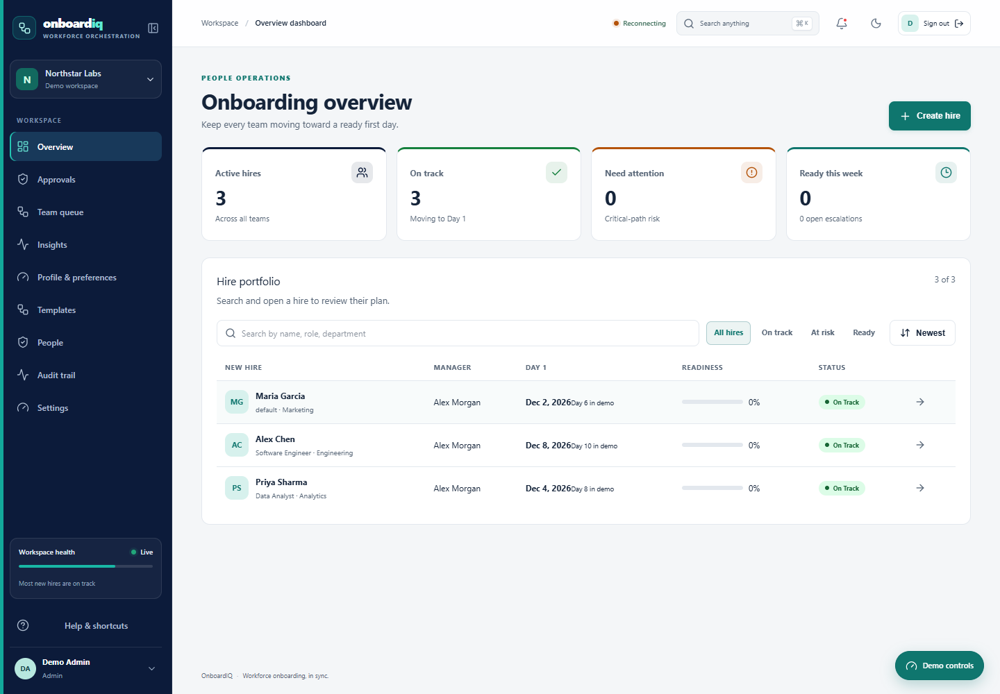
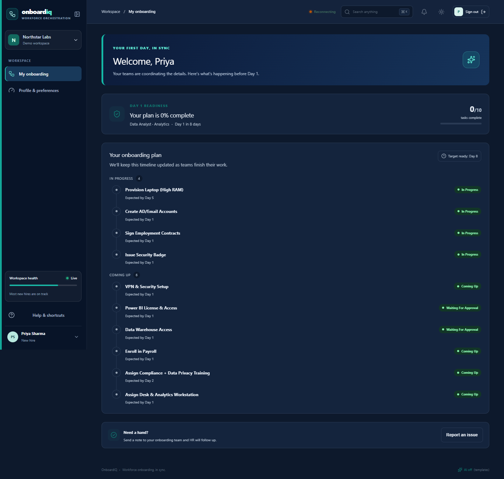

# Cross-Team Employee Onboarding Orchestrator

> **CAT2-029** · Local onboarding orchestration demo · November 2026

A multi-agent AI system that orchestrates cross-team (IT, HR, Facilities) employee onboarding with **critical-path scheduling**, **automatic stall detection**, **self-healing fallbacks**, and a governance layer — all vendor-neutral via MCP tools.

HR creates plans against a real joining date. The organization timezone and editable holiday calendar drive business-day mapping and projected-ready dates, while the demo clock keeps the scheduling scenario deterministic.

---

## 🚀 Quick Start

Prerequisites: **Python 3.11+** and **Node.js 20+**. The local demo uses SQLite; Docker, Postgres, SMTP, and an LLM key are not required.

Run the same command in Windows PowerShell, macOS Terminal, or Linux:

```bash
python run.py
```

The launcher creates a virtual environment, installs dependencies, creates `.env` with a generated signing secret, applies SQLite migrations, seeds the demo workspace, starts the API and frontend, checks health, and opens the browser. The API uses SQLite by default; Docker, an SMTP server, and an LLM key are optional.

Useful options:

```bash
python run.py --reset          # restore a fresh demo database
python run.py --test           # backend tests and frontend build
python run.py --no-browser     # start without opening a browser
python run.py --prod --no-browser  # serve the built UI and API on :8000
make verify                    # backend tests, frontend build, browser E2E + axe
npm --prefix frontend run qa:shots  # responsive screenshot matrix
```

For a repeatable local API baseline, start the app with `python run.py --no-browser`, then run
`python scripts/profile_api.py --requests 100 --concurrency 10` in another terminal. The profile logs in as the seeded
HR account and sends authenticated, read-only requests to the hire portfolio and metrics endpoints. Override
`ONBOARDIQ_PROFILE_EMAIL` and `ONBOARDIQ_PROFILE_PASSWORD` to use another HR account. The JSON report includes
throughput, status counts, and p50/p95/max latency; results describe the local machine and are not production SLOs.

In demo mode, use the account chips on `/login`. All six seeded accounts share `OnboardIQ-Demo!`: Admin, HR, Manager, IT, Facilities, and New hire. Role permissions are enforced by the API. Seeded people and ITSM/HRIS data are local demo records backed by deterministic MCP mock systems.

| Issue | What to check |
|-------|---------------|
| Port 8000 or 5173 is in use | Stop the service using that port, then rerun `python run.py`. |
| Wrong Node version | Install Node.js 20 or newer and verify with `node --version`. |
| Missing virtual environment | Run `python run.py` again; it creates `.venv` automatically. |
| SQLite database is locked | Close another app instance using `backend/onboarding.db`; then retry. Use `--reset` only when you want to recreate the demo data. |

No API key is required; unavailable LLM features use deterministic template text.

---

## 🏗 Architecture

```
┌──────────────────────────────────────────────────────────────────┐
│                   React Frontend (Vite + TS)                     │
│ HR · Manager · IT/Facilities · New Hire · Admin · Insights       │
│      Responsive role portals · audit · guided demo controls      │
└───────────────────────────┬──────────────────────────────────────┘
                            │  REST / JSON
┌───────────────────────────▼──────────────────────────────────────┐
│                    FastAPI Backend                               │
│  ┌───────────┐  ┌──────────┐  ┌───────────┐  ┌─────────────┐  │
│  │  Planner  │  │  CPM     │  │ Monitor   │  │ Experiment  │  │
│  │ (DAG gen) │  │ Engine   │  │  Tick     │  │ Simulation  │  │
│  └───────────┘  └──────────┘  └───────────┘  └─────────────┘  │
│  ┌────────────────────────────────────────────────────────────┐ │
│  │  SQLite · Idempotent Outbox · Audit Log · Notifications    │ │
│  └────────────────────────────────────────────────────────────┘ │
└───────────────────────────┬──────────────────────────────────────┘
              MCP stdio      │
        ┌────────────────────┼────────────────┐
        ▼                    ▼                ▼
    ITSM-MCP             HRIS-MCP       (plug in real
    (mock)               (mock)          ServiceNow/
                                         Workday MCP)
```

---

## 🎯 Key Differentiators

| Feature | How it works |
|---------|-------------|
| **U1 CPM Engine** | Forward/backward pass on live remaining durations; slack per task; negative slack = Day-1 at risk |
| **U2 Self-Healing** | Stall ≥ 2 idle days → escalate to Manager + IT → reschedule with fallback (loaner laptop = 1 day) |
| **U3 Vendor-Neutral** | Every external call goes through MCP stdio tools; swap mock for real in zero agent code changes |
| **U4 Reliability** | Idempotency key = `hire{id}:{task_key}`; outbox queue survives ITSM outage; zero duplicate tickets |
| **U5 Governance** | Manager approval gate for sensitive access; full audit log (day, actor, level, message) |
| **U6 Evidence** | 200-hire Monte Carlo: Orchestrator **~22 pp better** Day-1 readiness vs static checklist |

**LLM boundary:** Gemini is optional and used only for role-specific task suggestions, risk explanations, and escalation drafts. Validated deterministic fallbacks keep the product usable without a key. Scheduling, authorization, dispatch, and recovery decisions are code-driven.

---

## 📊 Experiment Results

| Policy | Day-1 Readiness |
|--------|----------------|
| Static Checklist | ~65% |
| Orchestrator | ~87% |
| **Improvement** | **+22 pp** |

> ⚠️ Illustrative Monte Carlo simulation (seed=42, n=200, stall_prob=0.2). Verify with production data.

---

## 🧭 Workspaces and interactions

- **HR:** hire list and creation wizard, readiness and critical-path detail, audit, insights, and export.
- **Manager:** assigned hires, access approvals and recent-action undo.
- **IT and Facilities:** team-scoped ticket queues with start, block, stall, complete, and comment actions.
- **New hire:** a privacy-scoped progress timeline and issue reporting.
- **Admin:** users/invites, versioned role templates, service guardrails, audit search/export, demo clock, and outage controls.
- **All roles:** responsive light/dark layouts, notification preferences, profile settings, keyboard navigation, and contextual demo controls.

The API schema is available at **http://localhost:8000/docs** while the app is running. TypeScript API contracts are generated from FastAPI OpenAPI with `npm --prefix frontend run typegen:api`.

## 🧰 Stack and boundaries

- **Backend:** Python 3.11+, FastAPI, Pydantic, SQLModel, Alembic, APScheduler, SQLite.
- **Frontend:** React, Vite, strict TypeScript, Tailwind CSS, TanStack Query, Recharts.
- **Integrations:** FastMCP stdio clients and persistent local mock ITSM/HRIS services.
- **AI:** optional Gemini for validated suggestions and copy; deterministic rules own workflow decisions.
- **Quality:** pytest, Ruff, Playwright, axe-core, coverage gate, and responsive screenshot matrix.

This is a local-first demonstration. The ITSM and HRIS services are mocks, outbound email is a local database outbox, and the experiment results are illustrative simulation data. Real vendor systems, SMTP delivery, production SSO, and production performance/security certification are not configured.

---

## 🎬 Demo Scenario

See [`docs/DEMO.md`](docs/DEMO.md) for the step-by-step Priya Sharma demo.

---

## 📸 Screenshots

The responsive matrix (all role routes at 390/768/1440 px, light and dark, plus the hire Graph and Schedule views) contains **198 screenshots** in [`docs/screenshots/`](docs/screenshots/).





---

## 📁 Project Structure

```
├── backend/
│   ├── app/
│   │   ├── main.py           # FastAPI app
│   │   ├── config.py         # Settings
│   │   ├── domain/models.py  # SQLModel entities
│   │   ├── db/database.py    # Engine + session
│   │   ├── services/
│   │   │   ├── cpm.py        # Critical Path Method
│   │   │   ├── planner.py    # DAG generation
│   │   │   ├── orchestrator.py # Dispatch, stall, reschedule
│   │   │   └── experiment.py # Monte Carlo simulation
│   │   └── api/              # FastAPI routers
│   ├── mcp_servers/          # ITSM + HRIS mock MCP
│   ├── tests/                # pytest suite
│   └── seed.py               # Demo data loader
├── frontend/                 # React + Vite app
├── docs/                     # Architecture, decisions, progress, demo, screenshots
├── qa/                       # Browser acceptance, accessibility, visual QA
├── docker-compose.yml
├── Makefile
└── .github/workflows/ci.yml
```
