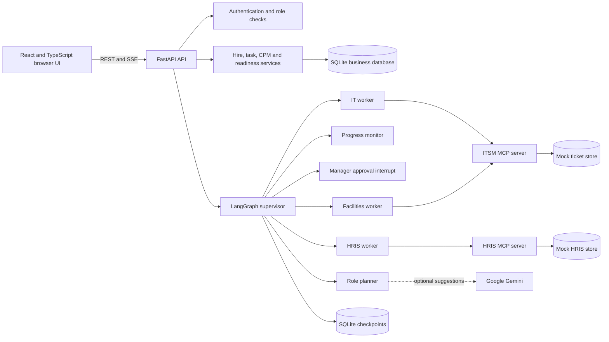
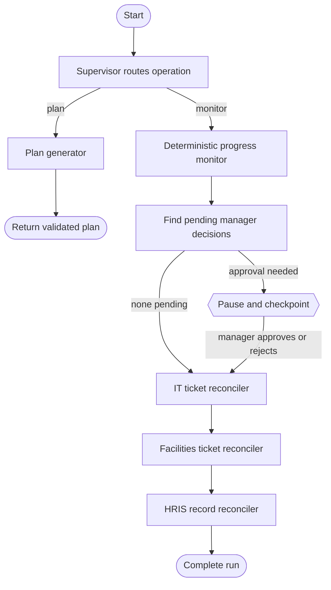
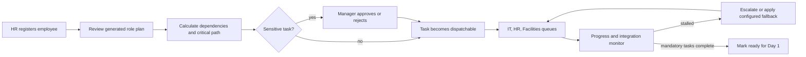
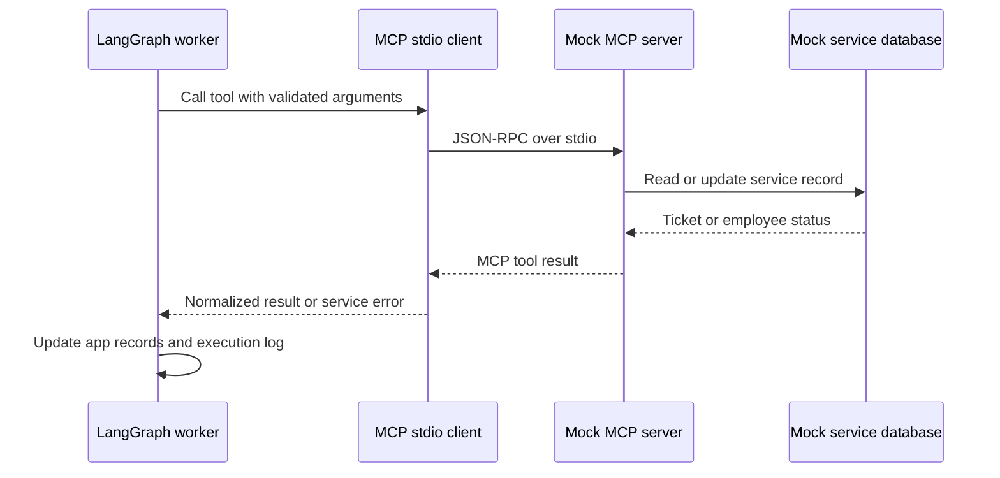
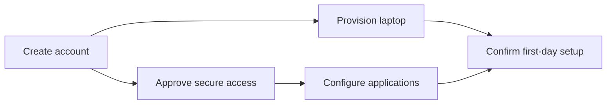
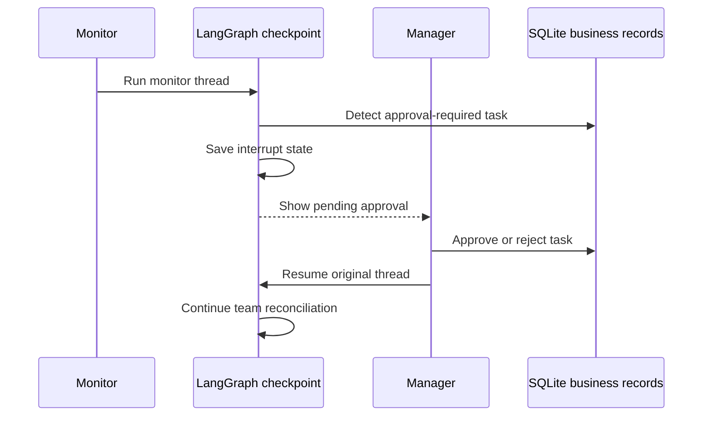
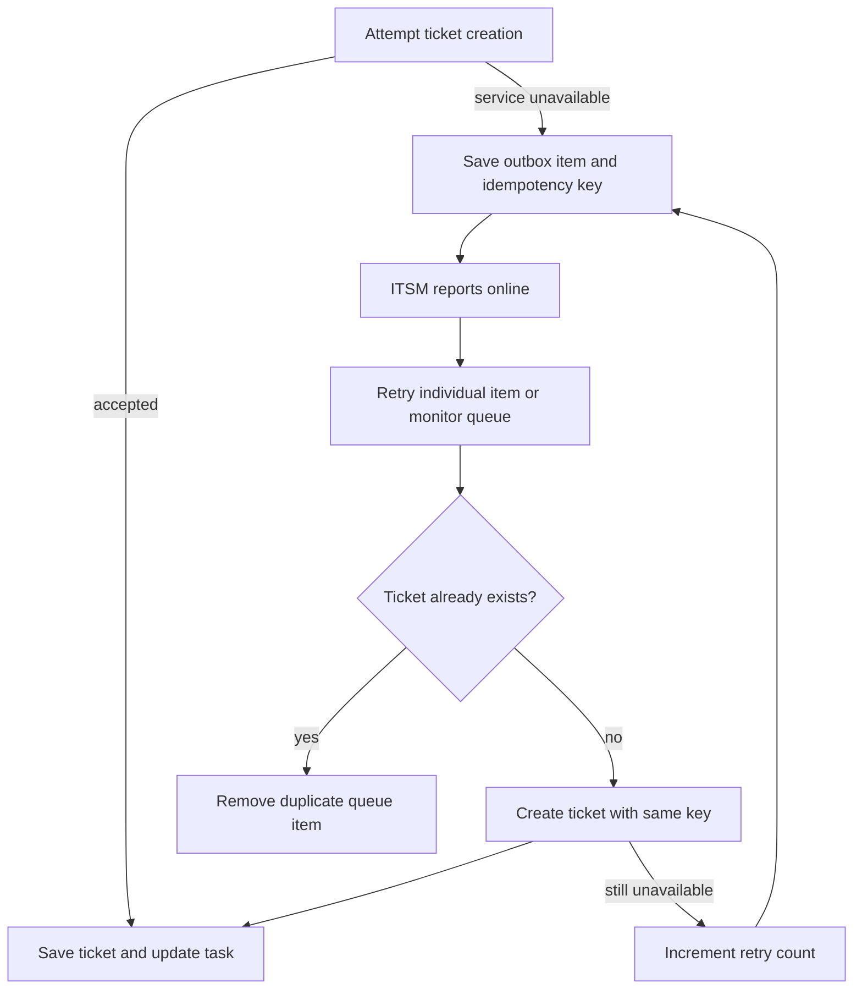
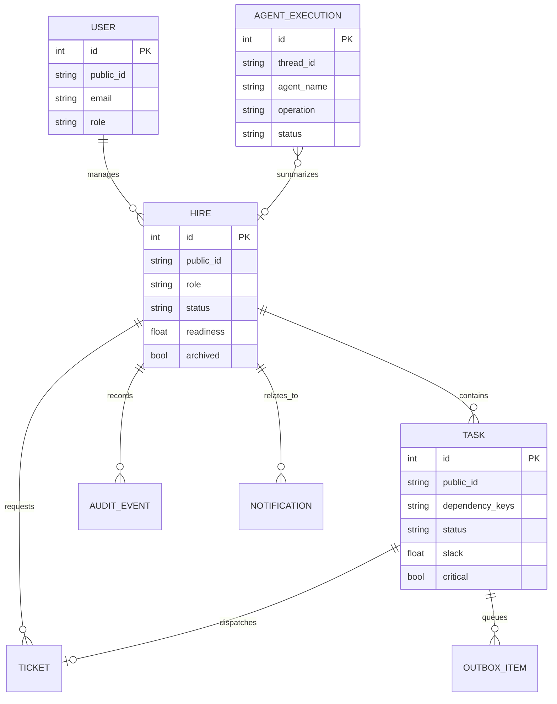

# OnboardFlow AI: architecture and how it works

## In plain English

OnboardFlow AI is a shared work tracker for the teams preparing a new employee's first day. HR creates an onboarding record. The app turns the role template into dependent tasks, works out which tasks can delay Day 1, and gives each team its own queue. A scheduled monitor keeps the record in sync with the task systems. A manager must approve sensitive work. The app records decisions and keeps retries safe if an integration is offline.

The AI model is optional. It may suggest wording or tasks. Normal access, approval, scheduling, ticket, readiness, and recovery decisions are made by validated application code.

## Technology in this repository

- **Web UI:** React 19, Vite, TypeScript, React Router, TanStack Query, Tailwind CSS, React Hook Form, Zod, React Flow, Recharts, and Lucide icons.
- **API:** Python 3.11, FastAPI, Pydantic 2, SQLModel/SQLAlchemy, and Alembic.
- **Workflow runtime:** LangGraph supervisor graph with `langgraph-checkpoint-sqlite`; checkpoints are stored separately from business records.
- **Database:** SQLite by default. Docker Compose and the Render blueprint persist it on a volume. The current deployment shape is a single backend process.
- **MCP:** Official MCP Python SDK with local ITSM and HRIS mock servers launched over stdio. The mock is simulated; it is not a real ServiceNow, Workday, or vendor account.
- **Model:** Optional Google Gemini `gemini-2.5-flash`. With no API key or an invalid response, the planner uses validated role templates and text explanations use safe fallbacks.
- **Reliability:** Idempotency keys, persistent outbox, monitor lease, retry counts, audit records, SSE notifications, and persisted graph checkpoints.

## System architecture

## What happens when HR starts onboarding

1. HR fills in the guided hire form. React Hook Form and Zod validate it in the browser; the API validates it again with Pydantic.
2. The API requests a role plan. LangGraph routes the request to the planner node. The planner loads a published role template, optionally asks Gemini for suggestions, validates the result as a dependency graph, then falls back to the deterministic template if needed.
3. The app saves the hire and task rows in SQLite. Task dependencies and durations feed the Critical Path Method (CPM), which calculates schedule slack and projected readiness.
4. The monitor runs on the APScheduler interval or an authorized manual action. A database lease prevents two processes from doing the same monitor tick at once.
5. The monitor identifies work that can start, waits for approvals where required, dispatches team tickets, checks for stalls, and applies only configured deterministic recovery rules.
6. IT and Facilities tickets are created through the ITSM MCP service. HRIS status is reconciled through the HRIS MCP service. If the ticket system is unavailable, the request stays in the outbox and can be retried safely.
7. The API saves agent execution summaries, business audit events, and notifications. SSE events tell open clients to refresh their API data. The dashboard, task graph, team queue, approval center, and agent center all read the persisted state.

## LangGraph supervisor and workers

The graph state contains identifiers and workflow summaries, not database sessions or secrets. A checkpoint thread ID is generated for each plan/monitor run. An approval uses LangGraph's interrupt mechanism; the manager endpoint records the decision, resumes the same thread, and allows the monitor to continue.

## Employee onboarding workflow

## MCP request and response

The MCP client starts its event-loop worker only on the first real stdio call. The mock servers run as subprocesses in the backend container, so they do not need separate containers.

## Critical path and dependency graph

This diagram illustrates the idea only. The app's React Flow graph uses task rows returned by the backend. The backend CPM calculation determines critical-path flags and slack; the browser does not infer them from colors.

## Human approval pause and resume

The decision in the database remains the business record; the graph checkpoint records where orchestration paused.

## Outbox retry and idempotency

## Database relationships

LangGraph checkpoints are in a separate SQLite file. That separation lets the app keep workflow recovery state independent from employee and task records.

## How to use the website

- **HR:** Open **Overview**, choose **Create hire**, check the role plan, then open a hire to review its overview, schedule, dependency graph, task list, what-if simulator, and activity.
- **Manager:** Open **Approvals**, review the employee and requested task, then approve or reject it. Decisions are recorded and sent back into the paused workflow.
- **IT or Facilities:** Open **Team queue** and update the tickets your team owns. The monitor reconciles those changes into the employee plan.
- **Admin:** Use **Agent center** to review node runs or manually start a monitor. Use **Integrations** to check MCP/model/scheduler status and retry queued ITSM work. Use **Audit trail** to review decisions.
- **New hire:** Open **My onboarding** to see assigned progress and report an issue to HR.
- **Everyone:** Use **Project guide** for the in-app tour and **Profile & preferences** for profile and notification settings.

## What is simulated and what is real

- Authentication, authorization, employee/task records, task graph, CPM, manager decisions, audit log, notifications, database checkpoints, ticket outbox, and workflow monitor are application features backed by this codebase.
- ITSM and HRIS are local mock servers accessed through real MCP stdio sessions. The mock is useful for development and demonstrations but does not contact enterprise vendor accounts.
- Gemini is optional. It is not the source of approval, access, readiness, schedule, or retry decisions.
- The Monte Carlo readiness comparison is illustrative simulation output, not a measured production result.
- The deployment files are templates. Creating public services requires the user's Render/Vercel accounts, environment variables, and a Render persistent disk. The Render blueprint is a paid single-instance shape because its SQLite business store and checkpoint store need persistent storage.
